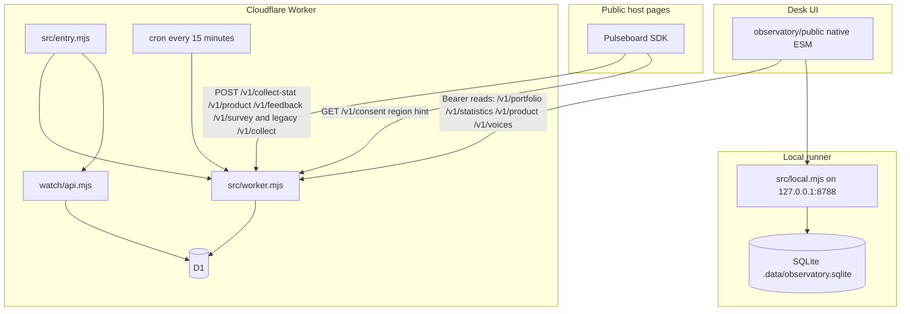
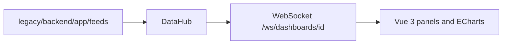

# Pulseboard


**A private desk for a small portfolio: bounded signals, explicit gaps, and a next check that still carries its source, window and limits.**

[](LICENSE)
[](observatory/package.json)
[](pyproject.toml)
[](https://github.com/Chris0Jeky/Pulseboard/actions/workflows/observatory.yml)
[](https://github.com/Chris0Jeky/Pulseboard/actions/workflows/desk-browser.yml)
[](https://github.com/Chris0Jeky/Pulseboard/actions/workflows/workbench-backend.yml)
[](https://github.com/Chris0Jeky/Pulseboard/actions/workflows/workbench-frontend.yml)
[](https://github.com/Chris0Jeky/Pulseboard/actions/workflows/python-package.yml)

[Open the hosted Desk](https://pulseboard-observatory.commit-atlas.workers.dev) ·
[Desk guide](observatory/docs/DESK_GUIDE.md) ·
[Architecture](observatory/docs/DESK_ARCHITECTURE.md) ·
[Hosting receipts](observatory/docs/HOSTING.md)

## What it is

Pulseboard is the operations desk for a portfolio of small public sites, plus the older feed workbench it grew out of. The useful output is not a score and not an automated reaction. It is an evidence-backed next check: source, time window, numerator, denominator, limitations and a proposed human action, kept together.

Two runtimes live side by side.

- **Desk** (`observatory/`) is the primary direction. A dependency-free Node collector and a native-ESM desk share one request handler. Production is a Cloudflare Worker and D1. Locally it is SQLite on `127.0.0.1`. Collection is off unless you set the allowlists yourself.
- **Workbench** (`legacy/`) is a frozen FastAPI and Vue 3 dashboard: pluggable feeds, a WebSocket per dashboard, ECharts panels. It stays green in CI and gets no new features. Historical readiness notes in `legacy/STATUS.md` are 2025-11 history, not a current certificate.

The split with the rest of the estate is deliberate. Developer Lens stays the authority for development analysis. CommitAtlas stays the public presentation layer. Taskdeck stays the local-first execution workspace: a Pulseboard finding can become a reviewed file, never a remote instruction.

Pulseboard keeps five states distinct, and it does not collapse them:

- **observation** — what a bounded source reported;
- **derived pattern** — a transparent calculation over observations;
- **hypothesis** — a question or a possible explanation;
- **operator declaration** — a human note, decision or incident statement;
- **missing evidence** — unavailable, stale, disabled or not integrated. Never silently turned into zero or success.

It does not infer causation from things happening near each other, average incomparable quantiles, identify people across products, or turn commit counts into a productivity score.

## Features

What the Desk actually serves, from `observatory/public/index.html` and `observatory/src/worker.mjs`:

| Surface | What you get |
| --- | --- |
| Overview, Alerts, Releases, Connections | Portfolio register, rule matches with evidence, release cohorts, and connections to protected reads. Keyboard: `1`–`4`, `/` to find a site, Ctrl/Cmd-K for the palette. |
| Usage (`5`) | Aggregate counts by event, route and release, plus separate per-dimension totals. Questions are leads from independent counts, not per-player rates. |
| Product (`6`) | Journeys for one tab session, web vitals as a p75 per route, error groups, and an explorer that reads raw events only when you ask. Alibi has a puzzle panel. |
| Voices (`7`) | Written feedback, survey answers and puzzle ratings that a player chose to send. Text is rendered as text. |
| Sample data | Four invented scenarios (release wobble, quiet portfolio, missing readings, event pressure) with a before/incident/recovery replay. They never reach collector storage. |
| Release comparison | Failure fractions with a descriptive 95% Wilson interval, and a nearest-rank p95 duration. Overlap is not treated as a significance test. |
| Field notes and handoffs | Markdown or JSON you preview and confirm before download. Imported claims stay separate from live readings. |
| GitHub evidence | One authenticated read, `GET /v1/github-evidence`, for the reviewed mapping. Today that mapping is Alibi only, and it stays off until `GITHUB_EVIDENCE_TOKEN` is set. |
| Security Watch | Receipt ingestion code ships in `observatory/watch/`. Hosted `WATCH_ENABLED` is `false`. It is not a scanner and it does not page anyone. |

The browser SDK (`observatory/sdk/pulseboard-sdk.mjs`, `SDK_VERSION` `3.3.1`) is one script built per project with `npm run build:sdk`. It shows a Beta bar with three consent categories (usage counts, diagnostics, journeys), honours Global Privacy Control and Do Not Track, and posts only to the collector. Hosts install it with [SDK.md](observatory/docs/SDK.md).

Admission is an allowlist per channel, not a global "tracking on" switch. A forged `Origin` still has to match the registered public origin. Daily budgets refuse the write instead of dropping fields. The collector does not store IP addresses or raw User-Agent strings; browser and OS are classified and the header is dropped. The one stored cross-visit handle is the SHA-256 of a player-chosen survey key, and only on the Voices tables.

## Architecture



The same `handle` function serves the Worker and the local process. The local runner does not probe public sites and does not call GitHub unless you export `GITHUB_EVIDENCE_TOKEN`. Cloudflare's cron runs `probeAll()` over the seven registered public origins (HTTP status, timing, and a content marker — not page content) and then `maintain()` for retention. Same-account targets (CommitAtlas, Alibi) are probed through service bindings because a Worker cannot fetch another Worker on the account through its public hostname. A separate GitHub Actions canary hits the public edge.

The frozen workbench is a different process and is not on this path:



## Quickstart

Node.js 22.16 or newer. The Desk runtime has no production npm dependencies and no build step. Wrangler is a dev dependency, used only when you deploy.

```bash
git clone https://github.com/Chris0Jeky/Pulseboard.git
cd Pulseboard/observatory
npm ci
npm test
npm start
```

Open `http://127.0.0.1:8788`.

- **Try sample data** needs no token. Invented numbers stay in the tab.
- The runner prints a read token when it generates one. If you export `READ_TOKEN` (at least 32 characters) it uses that and does not print it. Shorter tokens are refused with 401.
- The connect dialog can remember the token in this browser. Disconnect removes it. The token is never put in a URL or an export.
- A clean database is empty on purpose. Local collection stays disabled unless `COLLECT_ENABLED=true` and you set the channel lists.
- `PORT` defaults to `8788` and must be 1–65535. The bind address is `127.0.0.1`.

Hosted deploy, D1 migrations and the activation receipts are in [HOSTING.md](observatory/docs/HOSTING.md). Do not treat `npm run deploy` as part of trying the desk.

### Workbench

From `legacy/`, on Python 3.11+ (CI uses 3.13 for the app and 3.11 for the package build). On Linux and macOS the interpreter is `venv/bin/python`; on Windows it is `venv\Scripts\python`.

```bash
python -m venv venv
venv/bin/python -m pip install -r backend/requirements.txt
cd backend && ../venv/bin/python -m uvicorn app.main:app --reload --port 8000
```

Frontend, from `legacy/frontend/pulseboard-web`:

```bash
npm ci
npm run dev
```

That serves `http://localhost:5173`. The original user guide is [legacy/WORKBENCH.md](legacy/WORKBENCH.md). Docker compose lives under `legacy/` and is described in [legacy/DOCKER.md](legacy/DOCKER.md).

## Tech stack

| Piece | Choice |
| --- | --- |
| Desk runtime | Node.js `>=22.16` (`node:sqlite` locally; experimental warning on 22.x is expected) |
| Desk UI | Native ESM, HTML and SVG in `observatory/public/`. No bundler. |
| Production data | Cloudflare Worker, static assets, D1. Schema version **5** (`SCHEMA_VERSION` in `src/worker.mjs`). Wrangler `4.130.0`. |
| SDK | Dependency-free `observatory/sdk/pulseboard-sdk.mjs`, built per host. |
| Workbench API | FastAPI, Uvicorn, SQLModel, Pydantic. Python `>=3.11`. |
| Workbench UI | Vue 3, TypeScript, Pinia, Vue Router, ECharts, Vite, Tailwind. |
| Licence | GPL-3.0-only. Package version `0.1.0` in both `observatory/package.json` and `pyproject.toml`. |

Retention, from `maintain()` in `src/worker.mjs`: legacy session events 14 days, product events 90 days, aggregate counts 14 days (`AGGREGATE_RETENTION_DAYS`, held at 14 while deployed notices still say 14), feedback 365 days, survey answers and ratings 400 days, probe history 30 days.

## Status and roadmap

Checked against production `GET /readyz` on 12 October 2026, which matched `observatory/wrangler.jsonc`:

| Switch | Production value |
| --- | --- |
| `COLLECT_ENABLED` | `true` |
| `COLLECT_PROJECTS` (legacy session events) | `alibi` |
| `COLLECT_STAT_PROJECTS` (aggregate counts) | `alibi`, `portfolio`, `commitatlas`, `idleharbor`, `developer-lens`, `wealthlens`, `mdviewer` |
| `COLLECT_PRODUCT_PROJECTS` | `portfolio`, `alibi`, `commitatlas`, `idleharbor`, `developer-lens`, `wealthlens`, `mdviewer` |
| `COLLECT_VOICE_PROJECTS` | `alibi` |
| `WATCH_ENABLED` | `false` |
| Probes | seven public origins, cron `*/15 * * * *` |
| Readiness | schema 5, `ready: true` |

Taskdeck is registered as local-only: no public origin, no probe, not on a collect list. Adding a host to a collect list is an owner decision, not cleanup. Publishing an SDK does not by itself turn collection on.

[Usage plan v2](observatory/docs/USAGE_PLAN.md) is the measurement contract (owner decisions of 26–27 September 2026). [DESK_DIRECTION.md](observatory/docs/DESK_DIRECTION.md) is the written direction, last reconciled 15 September 2026, so it predates usage plan v2 and the Voices cutover. The open delivery issues are still the right backlog:

1. [One real journey](https://github.com/Chris0Jeky/Pulseboard/issues/18), from consent to a reviewed handoff, including a broken path.
2. [Hosted operability](https://github.com/Chris0Jeky/Pulseboard/issues/19): D1 parity, query budgets, rollback evidence. Deploy-lane gaps from the October 2026 census are [issue 213](https://github.com/Chris0Jeky/Pulseboard/issues/213).
3. [Mapped GitHub evidence](https://github.com/Chris0Jeky/Pulseboard/issues/20) beyond the Alibi CI workflow already in `src/github-map.mjs`.
4. [Journey canaries and an incident journal](https://github.com/Chris0Jeky/Pulseboard/issues/21).
5. [Reviewed Taskdeck and Lens bridges](https://github.com/Chris0Jeky/Pulseboard/issues/22), then a minimal public consumer.
6. [Private cost and run receipts](https://github.com/Chris0Jeky/Pulseboard/issues/23).
7. [One legacy feed as bounded Desk evidence](https://github.com/Chris0Jeky/Pulseboard/issues/24).

Also still open, and not implied by a green local test: jurisdiction for default-on statistics ([#99](https://github.com/Chris0Jeky/Pulseboard/issues/99)), the shared Voices daily budget ([#150](https://github.com/Chris0Jeky/Pulseboard/issues/150)), and survey writes that can overwrite a newer answer ([#218](https://github.com/Chris0Jeky/Pulseboard/issues/218)). There is no paging, automatic remediation, session replay or cross-product identity. A green demo is not a monitoring system.

## Documentation

- [Desk architecture and measurement semantics](observatory/docs/DESK_ARCHITECTURE.md)
- [Desk guide](observatory/docs/DESK_GUIDE.md)
- [Bridges and integration status](observatory/docs/DESK_BRIDGES.md)
- [Direction](observatory/docs/DESK_DIRECTION.md)
- [Usage plan](observatory/docs/USAGE_PLAN.md)
- [Voices contract](observatory/docs/VOICES.md)
- [SDK host guide](observatory/docs/SDK.md)
- [Hosting and activation receipts](observatory/docs/HOSTING.md)
- [Rollout gates](observatory/docs/ROLLOUT.md)
- [Asset provenance](observatory/docs/DESK_ASSETS.md)
- [Observatory module notes](observatory/README.md)
- [Workbench README](legacy/README.md) and [original workbench guide](legacy/WORKBENCH.md)

CI, from `.github/workflows/`: `observatory.yml` and `desk-browser.yml` on Desk changes; `workbench-backend.yml`, `workbench-frontend.yml` and `python-package.yml` for the workbench and the wheel; `collector-canary.yml` against the hosted edge twice an hour; `alibi-contract-watch.yml` daily; `deploy-observatory.yml` on `main` when the Cloudflare secrets exist; `sync-sites.yml` opens SDK-sync pull requests on host repositories. `handoff-producer.yml` checks the handoff producer on Ubuntu and Windows.

## Licence

Pulseboard is [GPL-3.0-only](LICENSE).

On 12 August 2026 the owner relicensed current and future owner-authored versions from MIT to GPL-3.0-only. Copies of earlier revisions stay available under MIT. See [RELICENSING.md](RELICENSING.md) and [LICENSES/MIT.txt](LICENSES/MIT.txt).

Dependencies and generated assets keep their own licences. Tailwind's MIT text ships with the workbench CSS. See [THIRD_PARTY_NOTICES.md](THIRD_PARTY_NOTICES.md).
